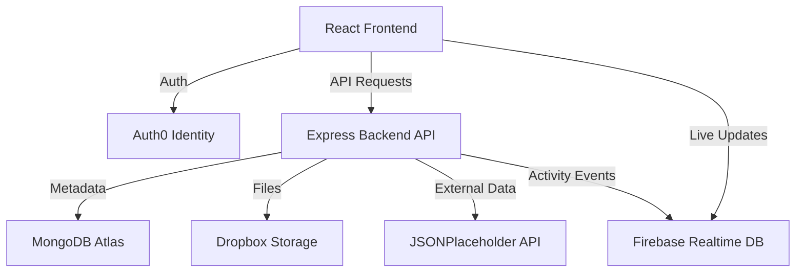

# CloudVault Architecture

## Overview
CloudVault is an integrated cloud file management system built as a modern SaaS web application. It integrates various cloud services to provide identity, database, real-time activity, external API consumption, and storage functionality.

## System Architecture

## Key Components
- **Client (Frontend)**: React, Vite, Tailwind CSS. Handles UI, routing, and Firebase subscriptions.
- **API (Backend)**: Express, Node.js. Serves REST API endpoints, validates requests, authenticates with Auth0, and proxies requests to Dropbox/Mongo.
- **Identity**: Auth0 (Experiment 4).
- **Database**: MongoDB Atlas (Experiment 6).
- **Storage**: Dropbox API (Experiment 5).
- **Real-Time**: Firebase Realtime DB (Experiment 3).
- **Third-Party**: JSONPlaceholder for REST consumption (Experiment 2).
